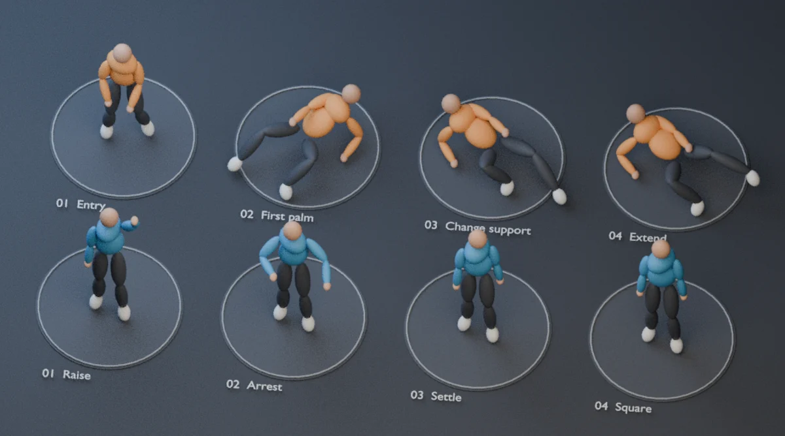
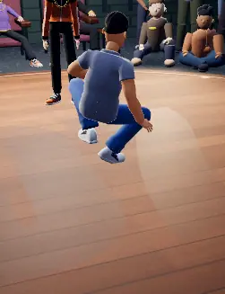
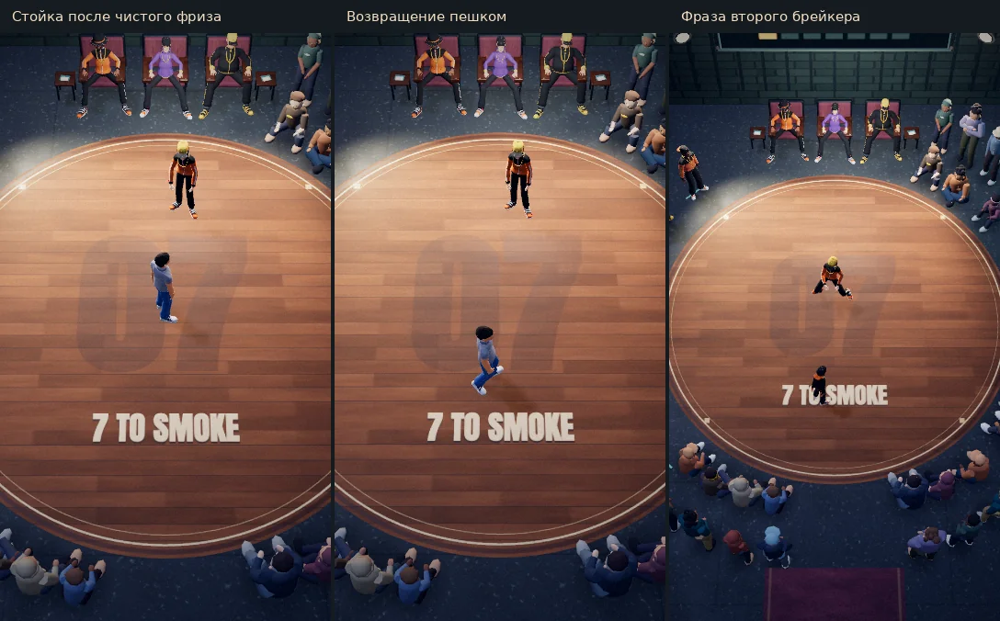
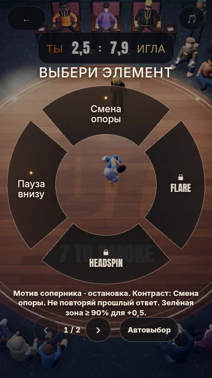

# Выходы и музыкальные ответы в городе

## Просмотренные выступления

Таймкоды относятся к указанной записи. Наблюдения описывают положение тела и последовательность видимых движений. Игровые связки и жесты поставлены для вымышленных персонажей.

| Запись и момент | Что видно | Что проверяем в игре |
| --- | --- | --- |
| Phil Wizard и Hong 10, 01:59,6–02:02. Финал BC One Paris 2023. [Запись Gong](https://gong.bg/oshte-sport/drugi-sportove/multimedia/video/finalyt-na-red-bull-bc-one-world-final-pri-bboys-759528) | Перед первым выходом оба сходятся, протягивают руки и расходятся. | Короткий открытый жест отдельного соперника оставляет середину круга свободной. |
| Phil Wizard, 02:38,6–02:46. Та же запись. [Финал](https://gong.bg/oshte-sport/drugi-sportove/multimedia/video/finalyt-na-red-bull-bc-one-world-final-pri-bboys-759528) | Из низкой формы поднимается, разворачивает корпус и отступает на свою сторону. Hong 10 начинает подход. | Отчётливый конец фразы, спокойная стойка и обычные шаги до своей позиции. |
| Hong 10, 02:56–03:01. Та же запись. [Финал](https://gong.bg/oshte-sport/drugi-sportove/multimedia/video/finalyt-na-red-bull-bc-one-world-final-pri-bboys-759528) · [Фото участника в сером](https://www.redbull.com/nl-nl/bc-one-world-final-samenvatting) | Из бокового шага переходит к компактной опоре, раскрывает ноги и снова собирает вес. | В одной фразе сочетаются шаг, смена высоты и короткая собранная форма. |
| Phil Wizard и Hong 10, 05:38–05:43. Та же запись. [Финал](https://gong.bg/oshte-sport/drugi-sportove/multimedia/video/finalyt-na-red-bull-bc-one-world-final-pri-bboys-759528) | Обнимаются после серии выходов. | Этот момент относится к завершению встречи. Освобождение круга между выходами опирается на отдельное наблюдение в 02:38,6–02:46. |
| Nicka, 00:33–00:42 и 00:52–00:57,2. Париж 2024. [Просмотренная запись](https://www.ganjingworld.com/video/1icg4808nsv6M41Vrw04kA8Eh1nk1c?t=33) · [Архив WDSF](https://www.worlddancesport.org/Paris2024) | В начале выходит вперёд, поднимает одну руку над головой и продолжает шаг. Позже переносит вес на руку и раскрывает ноги. | У соперников с акцентом на шаге возможен короткий подъём одной руки на входе. Движение на полу идёт после самостоятельного перехода. |
| Logistx, 01:57–02:02,2 и 02:23–02:31. Тот же олимпийский батл. [Запись](https://www.ganjingworld.com/video/1icg4808nsv6M41Vrw04kA8Eh1nk1c?t=117) · [Архив WDSF](https://www.worlddancesport.org/Paris2024) | Поворачивает плечи вокруг шага. Позже переносит движение с рук на плечо и спину, меняет рисунок ног и собирается в сидячую форму. | Низкая фраза продолжает движение через сбор ног. Траектория выхода подхватывает движение корпуса. |
| Kate, 00:00–00:04,2 отдельного ролика в материале VOA. [Материал VOA](https://projects.voanews.com/breakdancing/) · [Просмотренный клип](https://projects.voanews.com/breakdancing/img/video__kate__dancing__01.mp4) | Переносит вес, меняет направление ног и из низкой формы переходит в другую. | «Смена опоры» проходит через две ладони. В авторской «Дуге ноги» свободная стопа обходит точку опоры по дуге, таз разворачивается, другая нога подхватывает шаг. |

Ладонь у груди, жест в сторону свободного круга и спокойный кивок — варианты авторской постановки. Часть соперников сразу отходит шагом. Для героя использовано замечание владельца из практики. После чистой фразы он спокойно фиксирует стойку с одним из двух положений плеч и освобождает круг пешком. После срыва сначала восстанавливает равновесие и встаёт.

### Что может означать жест

В редакционном разборе BC One показ пальцев в счёт приводится как претензия к повтору своего материала. Медленные хлопки в такт описаны как возможный комментарий к попаданию соперника в музыку. Протянутая рука, которую нарочно убирают, приводится как пример провокации. В нашем просмотренном финале оба действительно соприкоснулись руками. Само положение руки ещё не определяет смысл. [Разбор тактики BC One](https://www.redbull.com/us-en/art-of-battle-strategies-breakdance)

Олимпийский словарь отделяет повтор своей связки от `biting` — обвинения в заимствовании чужого движения или стиля. В городе обычный пост-жест связан с освобождением круга. Претензии к повтору и поддёвки в эту постановку не входят. [Словарь NBC Olympics](https://www.nbcolympics.com/news/breaking-101-glossary)

## Пять районов

| Район | Фраза и действие |
| --- | --- |
| Двор | Топрок, ясная смена высоты, компактный футворк, пауэр или доступный футворк и привычный баланс фриза. Добавлены поворот по дуге и короткий сбор веса перед полом. |
| Центр | Выход по дуге с переносом веса, низкая связка с разворотом в обе стороны и возвратом в футворк. Акцент слышен в постановке, управление привычно. |
| Парк | Соперник показывает дугу ноги или смену опоры. Для игрового упражнения выбирай контраст в колесе и завершай фриз. |
| Промзона | В одном выходе возможны опора → подъём → повторная смена уровня или дуга ноги → продевание. Для зачёта вариации фриз чистый и хотя бы 85% времени в зелёной зоне. |
| Клуб | Темп и порядок задаёт выбранная пластинка и очерёдность 7 TO SMOKE. Первый развивает свой мотив. Второй показывает контраст и меняет предыдущий ответ. Точность фриза для зачёта от 90%. Опытный соперник в одной из форм делает короткий фриз на одной руке, приземляется и снова идёт вниз. Эта вставка не приносит очков сама по себе. |

Обе техники, «Смена опоры» и «Дуга ноги», доступны даже с исходным гардеробом и без выученного пауэра. Пока колесо открыто, герой непрерывно переступает, а турнирный таймер и счёт ждут выбора. При включённой музыке выбранная фраза подхватывает ближайшую половину доли. Контраст здесь — условие конкретного упражнения. В реальном батле на тот же музыкальный акцент можно ответить собственной вариацией. Игровые +0,5 зависят от выбранной и показанной техники и контроля фриза. У соперника точность моделируется отдельно, а срыв исключает зачёт. Автовыбор, пропуск и жесты очков за вариацию не дают. Базовые баллы, окна управления, тай-брейк, лимит 4:00 и правило «первый до семи» действуют в прежнем виде.

В свободном сайфере, показах и обычных раундах низкая связка ведёт к следующему шагу. Акцент можно показать изменением направления, раскрытием ног или сменой уровня. Держать позу уместно в техническом фризе, упражнении на баланс и на завершении раунда.

В очереди 7 TO SMOKE чужая дуэль показывает каждому спортсмену восемь музыкальных долей. Первые две — начало, следующие четыре — связка, последние две — ясная конечная форма. Проход до центра и обратно идёт настоящей ходьбой. «До моего выхода» списывает с турнирного таймера остаток именно той встречи, которую пропускаешь.

## Blender и проверка









Оригинальные траектории поставлены на существующем скелете. Для опорных фаз проверены высота обеих кистей и перенос корпуса в сторону опоры. Базовые записи движения уже входят в лицензированную библиотеку проекта Mixamo. Публичные батлы использованы для наблюдений, без извлечения анимации в игру. [Условия Adobe Mixamo](https://helpx.adobe.com/creative-cloud/faq/mixamo-faq.html)

```sh
node tools/mocap/build_city_breaking.mjs
blender -b -t 4 --python tools/mocap/render_festival_study.py -- /tmp/city-battle-study.png battle
node tools/test_city_battles.mjs
```

Проверка на 360×640 покрыла штатный выбор, удержание фриза, стойку, обычный шаг, просмотр пары NPC и пропуск до своего выхода. В клипе дуги опорная ладонь держится примерно в 6–7 см от пола. Модель свободной стопы проходит больше полуметра от передней точки к боковой. Проверка на каждом интервале по четыре кадра подтверждает движение стоп, таза или рук в дуге, цикле колеса, связке с разворотом корпуса и backspin. В цикле колеса положения суставов совпадают на стыке.

Проверка на двух пластинках подтверждает бюджеты одной пары 13,28 с при 122 BPM и 12,54 с при 134 BPM для просмотра и пропуска. Расчёт по длительности стандартных фраз с базовым ответом даёт достижимый маршрут семи подряд побед примерно за 229 с и 225 с соответственно при чистом исполнении. В браузере проверена полная пара и вход в следующую очередь. Семь побед подряд проверены расчётом времени и тестом очереди.
