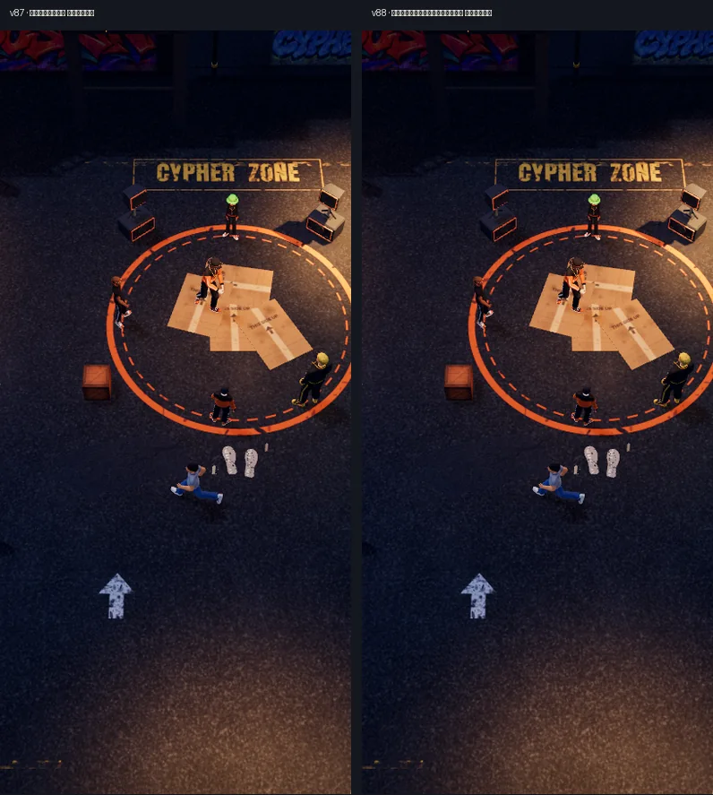

# Рендер 3D города на «Ультра»

Сцена рисуется в полноразмерный HDR-буфер с 4× MSAA. Bloom по-прежнему использует пять уровней размытия. Его результат добавляется к линейному HDR-цвету в финальном шейдере перед той же тональной кривой, виньеткой и зерном. Проход разрешает цвет один раз. До изменения он разрешал цвет и глубину после сцены и снова после наложения bloom. Финальному шейдеру нужна только текстура цвета.

В цветном проходе остаётся исходная модель человека. Для глубины теней используется сетка из её же вершин и весов скелета. Она убирает мелкие складки, нитки и детали, которые повторяют общий силуэт. Нижняя грань подошвы сохраняется при объединении вершин. Движения, одежда, опора кистей и стоп используют прежний скелет. Статичная глубина закреплённых фонарей переиспользуется, пока свет и геометрия совпадают. На улице проекция лунной карты привязана к сетке 0,75 м. Смещение от центра вида до 0,53 м помещается в исходный запас проекции 0,8 м. Движущиеся тени обновляются по прежней схеме.

## Измерение

Chromium со SwiftShader, CSS-окно 402×874, DPR 3, выбранные «Ультра» и 60 кадров. Реальный буфер 1177×2560, 4× MSAA, полный композер и тени. Шейдеры прогреты до измерений. Сравнивали v87 и v88 по времени между отрисовками, вызовам renderer.info.render и маскам blitFramebuffer. На стенде нет GPU iPhone. Интервалы относятся к программному рендеру и не оценивают FPS телефона.

Двор, короткое движение к кругу с подвижной камерой. Восемь кадров на версию после разгона, значения медиана и p95. При таком размере выборки p95 фактически соответствует худшему кадру.

| Показатель | v87 | v88 |
| --- | ---: | ---: |
| Отправлено треугольников в тени | 402 459 / 739 443 | 124 591 / 156 285 |
| Отправлено треугольников за кадр | 607 830 / 944 814 | 329 703 / 361 397 |
| Вызовы отрисовки | 126,5 / 149 | 115,5 / 136 |
| Интервалы кадров SwiftShader, мс | 4 911 / 6 076 | 4 655 / 5 266 |
| Полноразмерные копии цвета и глубины за кадр | 2 + 2 | 1 + 0 |

В загруженной сцене Двора 21 сетка персонажей имела отдельный теневой силуэт. Сравнение одной и той же позы и камеры подтвердило побитовое совпадение цвета при переключении способа смешивания bloom. С заменой геометрии средняя разница канала составила 0,0032 по шкале 0–255. На рисунке показаны оба кадра.

Уличный контроль в Центре, пять кадров на версию. Тени сократились с 463 098 / 587 463 до 117 918 / 128 019 треугольников. Сумма за кадр сократилась с 612 180 / 694 135 до 247 773 / 266 999. Вызовы отрисовки изменились со 123 / 134 до 104 / 118. Интервал программного кадра составил 4 700 / 4 854 мс в v87 и 3 716 / 4 088 мс в v88.

В Клубе с камеры входа зафиксированы семь танцоров очереди и 28 зрителей в обеих версиях. При обновлении карты теней отправлено 291 611 треугольников в v87 и 71 189 в v88. Суммарная геометрия такого кадра снизилась с 665 874 до 445 451 треугольников при 131 и 130 вызовах. Интервалы пяти кадров без отбора составили 4 212 / 4 482 мс и 3 613 / 7 504 мс. Пиковый интервал в этой серии вырос на программном стенде, поэтому сравнение в Клубе опирается прежде всего на совпадающий проход рендера и фактическую геометрию.

## Повторение замера

- В Chromium с мобильным viewport 402×874 включить DPR 3, «Ультра» и 60 кадров. Прогреть сцену и дождаться заполнения статичных карт теней. UI не меняет качество при замедлении.
- Во Дворе пройти от стартовой позиции в сторону круга. В Центре использовать тот же вход и движение прямо от точки появления. Для неподвижной выборки не трогать камеру после её остановки. Сравнивать несколько последовательных кадров каждого режима и отдельно пик при обновлении карт теней.
- Для Клуба сначала снять зал с камеры входа, затем начать 7 TO SMOKE и выбрать фазу одного и того же выходящего соперника. Число зрителей в зале остаётся 28.
- Сбросить renderer.info перед каждым вызовом полного comp.render, отключив только автоматический сброс счётчиков. Собирать кадры по реально вызванному рендеру. Число кадров, GPU-проходы и скриншоты сохранять по каждому варианту. Время отправки команд с CPU, интервалы кадров и данные таймера WebGL измерять отдельно.
