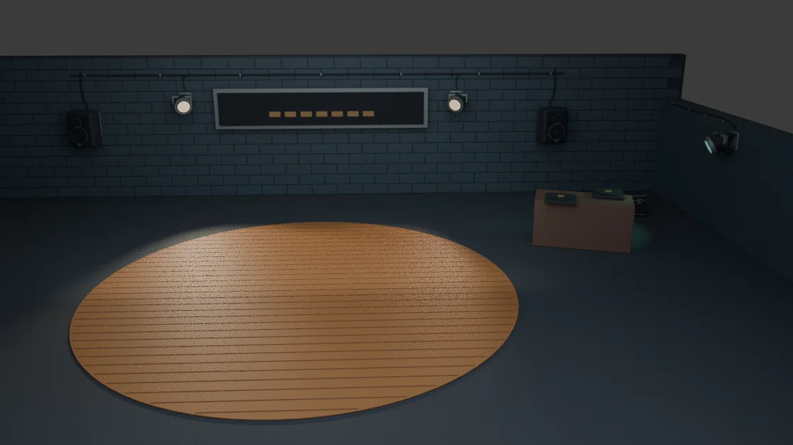
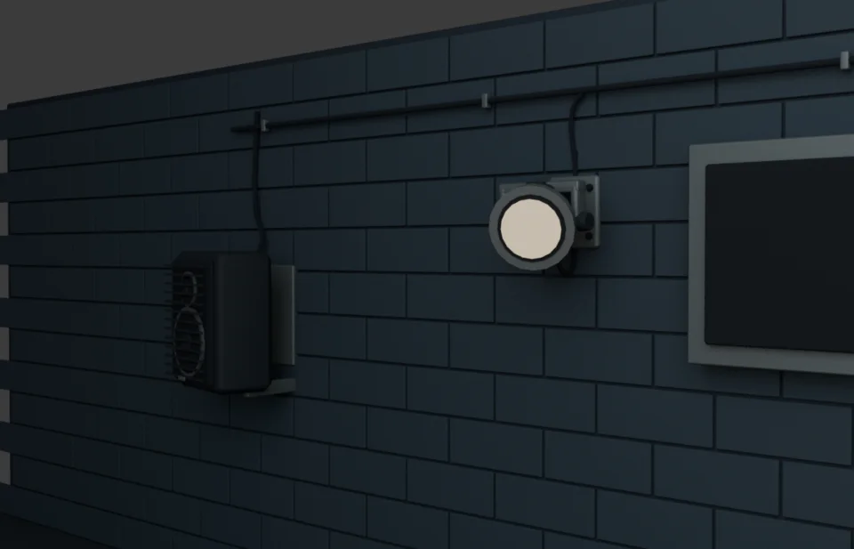
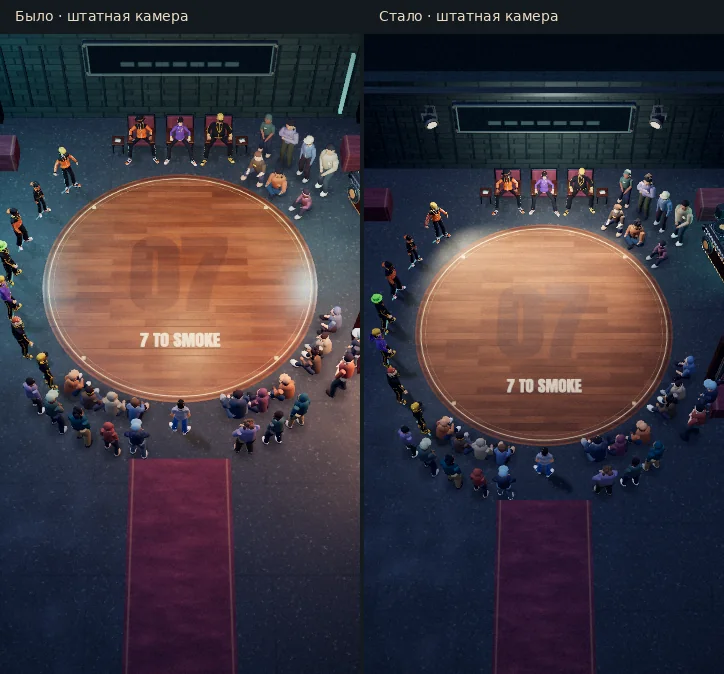
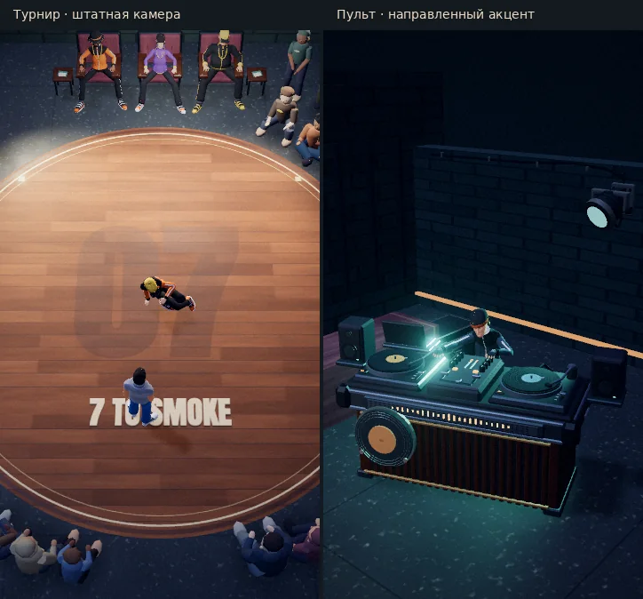

# Свет и звук в Клубе

Штатная камера видит свободный паркет, судей, табло и световые приборы на задней стене. Световой рисунок держится на тёплых перекрёстных лучах, мягком отражении и небольшом прохладном пятне у диджея. Публика остаётся чуть темнее. Два PA на стене направлены к кругу, провода собраны у кирпича, сервисный кофр стоит позади пульта.

## Визуальные источники

- На официальном кадре Acres23 пульт и оборудование занимают края, ближние к диджею люди сидят у пола. В Клубе подход к пульту оставлен со стороны круга. [Площадка](https://www.acres23.co.uk/) · [Кадр](https://cdn.prod.website-files.com/696d6c20a3a61c55da5de6ea/697a538c6d1f8ede9ed51039_slider-2-p-3200.jpg)
- На джеме Flow Mo Anniversary танцора видно в тёплом объёме. Цветной боковой свет локально выделяет край пола и публику. Отсюда тёплый ключ на паркете и приглушённый цвет в зоне пульта. [Репортаж Red Bull](https://www.redbull.com/fi-fi/flow-mo-14th-anniversary-viikonloppuna) · [Кадр круга](https://img.redbull.com/images/c_limit,w_980/q_auto,f_auto/redbullcom/2016/05/26/1331797088113_3/flow-mo-crew-anniversary)
- В техническом листе Kunstraum показана постановка живых выступлений в зале на 100 человек. В спецификации две закрепляемые PA, на фотографии оборудование и свет поставлены вдоль края. В нашей комнате это крепления в кирпиче и разводка по стене. [Технический лист, стр. 3](https://kunstraum.org.uk/wp-content/uploads/2022/02/Kunstraum-venue-info.pdf#page=3)

## Оригинальный референс и игровой монтаж









За положение и направление прожекторов отвечают точки линзы и прицела в той же Blender-модели, в которой сделаны корпуса, дужки и кронштейны. Три направленных прибора и мягкий отражённый свет укладываются в прежний бюджет Клуба. Комнатное окружение и существующие тени персонажей сохранены. У световых приборов нет собственных карт теней.

Свет в простое постоянный. Во время выхода танцора в круг интенсивность слегка поднимается и опускается раз за четыре доли звучащей композиции. Для 7 TO SMOKE используется музыкальный такт текущего трека, для выступления фестиваля — такт его партии. Задний отражённый свет остаётся постоянным. Во время паузы, голосования, перемещения, при выключенном звуке и в режиме уменьшенного движения свет возвращается к штатной интенсивности.

### Воспроизведение

```sh
blender -b -t 5 --python tools/build_club_lighting.py -- --out /tmp/club-lighting
python -m http.server 8803 --bind 127.0.0.1
```

Скрипт обновляет игровой `anim/club-lighting.glb` и создаёт два PNG, использованных на этой странице. Чтобы обновить только модель, добавьте `--skip-render`. Для сравнения входа откройте `http://127.0.0.1:8803/city3d.html?d=club&fps` размером 450×650 с исходным масштабом камеры.

### Проверка нагрузки

Модель весит 243 КБ. В ней шесть материалов, шесть примитивов и 6728 треугольников. В сравнении A/B/B/A с фиксированной камерой и той же теневой картой видимая модель занимает четыре вызова отрисовки при входе и пять у пульта. У прежних пяти локальных источников было разлитое освещение. В новой схеме четыре локальных источника, три из них направленные.

На мобильной геометрии 360×640 и DPR 2,5 проверены штатные HD/30, FHD/60 и Ultra/60. В HD буфер ограничен 720×1280, в FHD и Ultra остаётся нативным 900×1600. Числа от программного WebGL проверяют настройки и бюджет сцены. FPS физического телефона в этом прогоне не измерялся.
